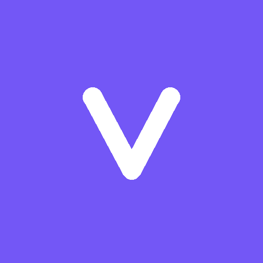

# Guía de marca de VirGo

Esta guía reúne la identidad de **VirGo** para que la app, la landing page, la ficha de Google Play y cualquier presentación se vean y suenen igual.

## 1. Quiénes somos

| | |
|---|---|
| **Nombre** | VirGo (con «G» mayúscula; nunca «Virgo», «VIRGO» ni «Vir Go») |
| **Qué es** | Una app que reúne salones y proveedores para organizar eventos en un solo lugar |
| **Para quién** | Personas que organizan una fiesta, boda, XV años o evento, y los salones y proveedores que les dan servicio |
| **Promesa** | Organizar un evento sin hojas de cálculo, llamadas ni chats dispersos |
| **Eslogan** | **Solo dale GO.** |
| **Desarrollador** | KarasuDev |

El nombre une *Vir* (de *venue*, salón) con *Go* (ir, avanzar). Por eso la «G» va en mayúscula y el botón principal de la marca dice **GO**.

## 2. Logo

{: width="128" height="128"}

- Una «V» blanca de trazo redondeado sobre un cuadro morado con esquinas redondeadas.
- Archivo: [`assets/virgo-icon.png`](../assets/virgo-icon.png), 512 × 512 px.
- **Espacio libre:** deja alrededor del logo al menos la mitad de su ancho sin otros elementos.
- **Tamaño mínimo:** 32 px en pantalla.

**No hagas esto:**

- Cambiar el color del fondo o de la «V».
- Estirarlo, girarlo o agregarle sombras y contornos.
- Ponerlo sobre fotos sin contraste. En ese caso usa el logo sobre su cuadro morado.

## 3. Colores

Son los mismos *tokens* del sistema de diseño de la app (`core/designsystem/theme/Color.kt`).

| Muestra | Nombre | HEX | Uso |
|---|---|---|---|
| 🟪 | **Morado VirGo** | `#7357F6` | Color principal: botones, enlaces, el logo |
| 🟪 | Morado oscuro | `#6244EA` | Botón presionado o *hover* |
| ⬜ | Morado claro | `#F3F0FF` | Fondos de tarjetas y chips |
| ⬛ | Pizarra 900 | `#0F172A` | Texto principal y fondo del modo oscuro |
| ◼️ | Pizarra 500 | `#64748B` | Texto secundario |
| ⬜ | Pizarra 50 | `#F8FAFC` | Fondo claro de secciones |
| 🟩 | Verde éxito | `#21A668` | Confirmaciones y estado «Disponible» |
| 🟥 | Rojo error | `#EB5757` | Errores |
| 🟨 | Amarillo aviso | `#E6A937` | Advertencias |

**Proporción recomendada:** 60 % blanco o pizarra, 30 % texto oscuro y 10 % morado. El morado destaca porque se usa poco.

**Accesibilidad (WCAG 2.2):**

| Combinación | Contraste | Nivel |
|---|---|---|
| Blanco sobre Morado VirGo `#7357F6` | 4.75 : 1 | AA |
| Blanco sobre Morado oscuro `#6244EA` | 5.94 : 1 | AA |
| Pizarra 900 sobre blanco | 17.85 : 1 | AAA |
| Pizarra 500 sobre blanco | 4.76 : 1 | AA |

No pongas texto morado sobre fondos morados ni texto gris claro sobre blanco.

## 4. Tipografía

| Uso | Fuente | Pesos |
|---|---|---|
| Títulos | **Manrope** | 600, 700 y 800 |
| Texto y botones | **DM Sans** | 400, 500 y 700 |

Las dos son gratuitas (SIL Open Font License) y vienen dentro de la app y del sitio, así que funcionan sin conexión y sin enviar datos a terceros.

## 5. Tono de voz

VirGo habla como una amiga organizada que te quita trabajo de encima.

| Somos | No somos |
|---|---|
| Cercanos: hablamos de «tú» | Formales ni corporativos |
| Claros: frases cortas y verbos directos | Técnicos («endpoint», «API», «backend») |
| Optimistas: el evento va a salir bien | Exagerados («¡¡la MEJOR app!!») |
| Honestos: si algo viene «próximamente», lo decimos | Prometedores de lo que todavía no existe |

**Ejemplos:**

- ✅ «Encuentra salones cerca de ti.» ❌ «Optimiza la gestión de recintos para eventos.»
- ✅ «No hay conexión. Revisa tu internet e inténtalo de nuevo.» ❌ «Error 503: Service Unavailable.»

## 6. Imágenes

- Personas reales disfrutando eventos: fiestas al aire libre, luces cálidas, mesas montadas.
- Contraste entre el «antes» (estrés, hojas de cálculo) y el «después» (la fiesta), como en el video de la landing.
- Capturas de la app **sin datos personales de nadie real**.

## 7. Dónde se aplica

| Canal | Recursos |
|---|---|
| App Android | Tema de `core/designsystem` |
| Landing page | [virgorent.github.io/VirGO_Movil](../) |
| Google Play | Ícono 512 × 512, gráfico destacado 1024 × 500 y capturas en proporción 2:1 |
| Correo de contacto | `virgorent6@gmail.com` |

---

[Volver al inicio](../) · [Aviso de privacidad](../legal/privacidad/)
